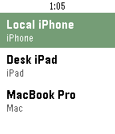
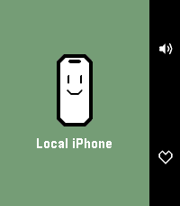

# FindMy for Pebble

A Pebble watch app that lists your Apple devices and plays a Find My sound on
them from your wrist. The watch UI is native C; everything else — Apple
sign-in, 2FA, session state, device sync, ping requests — runs in the
PebbleKit JS (PKJS) runtime on your phone and talks directly to Apple. There
is no third-party backend.

| Device list | Detail | Pinging |
| --- | --- | --- |
|  |  |  |

## What it does

- lists the devices visible to your Apple account
- plays a Find My sound on a chosen device
- remembers a default device for one-click pinging
- optionally opens straight into a device of your choice at launch ("Open at
  launch" in settings, once signed in)
- Apple sign-in and 2FA (trusted-device code or SMS) from the phone settings
  page
- a collapsible sanitized-log viewer with one-tap copy in the settings page

What it does **not** do: location display, erase/lock/lost mode.

## Disclaimer

This is an unofficial hobby project. It is not affiliated with, endorsed by,
or sponsored by Apple. "Apple", "iCloud", and "Find My" are trademarks of
Apple Inc., used here only to describe what the app talks to.

The app signs in the same way iCloud.com does, using web endpoints that Apple
does not document or support for third-party use. Apple may change or block
them at any time, and using them may be contrary to Apple's terms of service.
Use at your own risk.

## Privacy and credentials

Read this before signing in — you are typing your Apple ID password into a
third-party app's settings page:

- Your Apple ID and password are sent **only to Apple** (`idmsa.apple.com`
  and iCloud Find My endpoints), directly from the PKJS runtime inside the
  Pebble phone app. There is no server of ours in between.
- The password is **stored on your phone** (in the Pebble app's PKJS local
  storage) so the app can silently re-authenticate when the iCloud session
  expires. Signing out deletes it along with all session state.
- The settings-page log viewer redacts passwords, tokens, cookies, and
  sensitive URL fragments before log lines are stored, and logs never leave
  the page unless you copy them yourself.

See [SECURITY.md](SECURITY.md) for the finer points and how to report issues.

## Supported watches

`aplite`, `basalt`, `chalk`, `diorite`, `emery`, `flint`, and `gabbro` —
original Pebble through Core Devices hardware, round and rectangular.

## Building

Prerequisites:

- Node.js 20+ and npm 10+
- the [Rebble SDK toolchain](https://help.rebble.io/sdk/) (`pebble` CLI)

```bash
npm install
npm run build            # builds every workspace
npm run bundle -w pebble # packages the watch app → pebble/build/pebble.pbw
```

`npm run bundle` stages the pebble package in a temp directory before
running `pebble build` — running `pebble build` directly inside the repo
fights the npm-workspaces layout (the SDK's own npm step empties
`pebble/node_modules`).

### Run in the emulator

```bash
npm run install:emery -w pebble   # bundle + install (any target platform name)
```

If the emulator gets stuck, clear stale launcher processes with
`pebble kill --force`.

### Install on a real watch

Enable the developer connection in the Pebble/Rebble phone app
(Settings → Developer Connection), then from `pebble/`:

```bash
pebble install --phone <your-phone-ip> --logs
```

or sideload `pebble/build/pebble.pbw` from your phone.

## Repo layout

Everything lives under [`pebble/`](pebble): the C watch UI
([`src/c`](pebble/src/c)), the TypeScript PKJS runtime
([`src-ts/pkjs`](pebble/src-ts/pkjs)), and a small WASM crypto module
([`tools/wasm`](pebble/tools/wasm)) that accelerates SRP sign-in.

The TypeScript in `pebble/src-ts/` is compiled to ES5 in `pebble/src/` (the
PKJS engine on older phones is ancient), and the compiled output is committed
because `pebble build` consumes it directly. CI verifies the two stay in
sync — run `npm run build -w pebble` after editing `.ts` files.

## Testing

```bash
npm test   # WASM crypto parity harness (WASM vs Node native crypto)
```

## License

[MIT](LICENSE). Bundled third-party packages are listed in
[THIRD-PARTY-NOTICES.md](THIRD-PARTY-NOTICES.md), with thanks to
[pyicloud](https://github.com/picklepete/pyicloud) for documenting Apple's
SRP protocol behavior.
